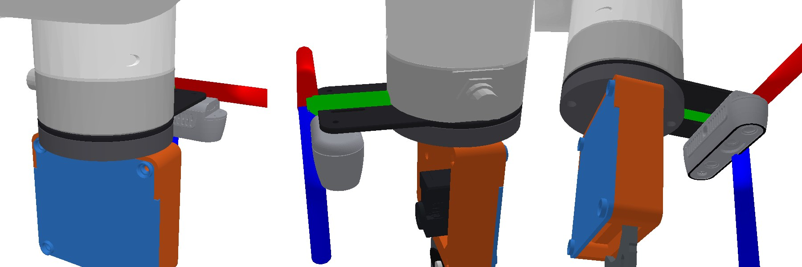
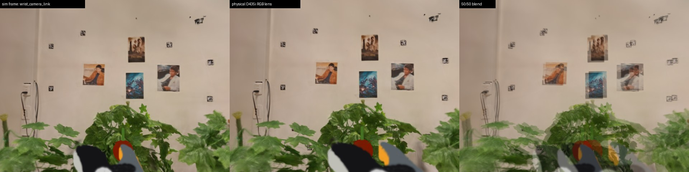
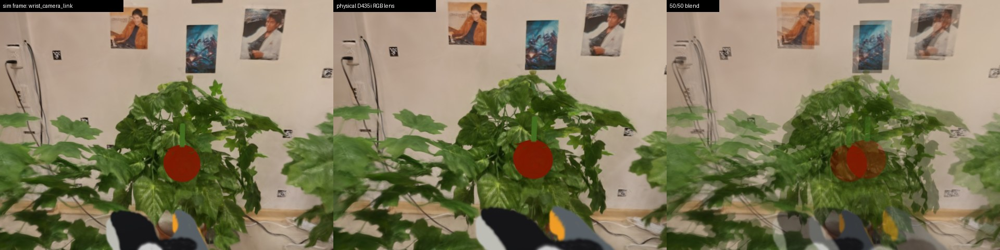
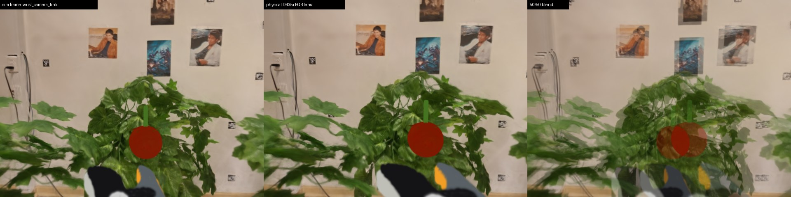

# Wrist camera: sim frame vs. the physical D435i lens

Date: 2026-11-12. Scene: `xarm5_lite_plant_v3_hand_held_down`.

The sim renders `wrist_rgb` from `wrist_camera_link`, a fixed frame on `link_eef` at
`xyz (0.08, 0, 0)`, `rpy (0, 0, 1.5708)`. The real D435i is bolted to the Camera Stand_1300 plate.
This experiment renders both poses side by side to show how far apart they are. The sim frame was
**not** changed.

## Where the physical lens is

The stand is a 3 mm plate clamped between the xArm flange and the gripper mount (`mount_xarm5`).
Its disc is centred on the flange axis, and a tab sticks out along +x of `link_eef`. The tab has two
M3 holes 45 mm apart at x = 67.5 mm, which match the M3 mounts on the back of the D435i. So the
camera's back sits on the plate and it looks along the tool axis (+z).

Using Intel's D435 housing model (`realsense2_description/meshes/d435.dae`, which the D435i shares),
the RGB optical centre ends up at:

| frame (in `link_eef`, mm) | x | y | z | axes |
|---|---|---|---|---|
| sim: `wrist_camera_link` | 80.0 | 0.0 | 0.0 | image x = +y, looks along +z |
| physical D435i RGB lens | 67.5 | −32.4 | 23.8 | same |
| difference | −12.5 | −32.4 | +23.8 | |

In the camera's own axes, the physical lens is 32.4 mm to the left, 12.5 mm down in the image and
23.8 mm further forward. The rotation is the same; the plate is flat, so the camera looks straight
along the tool axis.



*The model in the URDF: the stand plate between the flange and the gripper, and the D435i under the
tab. The red, green and blue axes are `wrist_camera_link`, the frame the sim renders from.*

## Renders

Each row shows: the sim frame | the physical lens | a 50/50 blend. Both cameras use the same
intrinsics (`WRIST_CAM_FOV`, 640×480), so the only difference is the pose.

| pose (joints 1–5, rad) | tomato depth | tomato pixel shift (u, v) |
|---|---|---|
| 0: `0 -0.4886 -0.5235 -0.6108 0` (scene start) | 52.5 cm | (+26, −1) = 26 px |
| 1: `0 -0.1 -0.9 -0.3 0` | 41.6 cm | (+34, −8) = 35 px |
| 2: `0 0.15 -1.0 -0.6 0` | 36.6 cm | (+39, −7) = 40 px |





## What it shows

- **Most of the error is sideways.** The 32 mm offset across the image moves the tomato 26–40 px
  (4–6 % of the width). The shift grows as the camera gets closer, so it is largest during the final
  approach, which is when the wrist camera matters most.
- **The gripper moves the most.** It is a few centimetres from the lens, so it lands in a visibly
  different part of the image. A policy trained on sim wrist images sees the jaws in a different
  place than on the real robot.
- **The background barely moves.** Walls and posters shift a few pixels, so whole-image
  comparisons understate the problem.

## Caveats

- **Which way round is the camera?** I assumed the image's x points along +y of `link_eef`, the
  same as the sim frame. If the D435i is bolted the other way round, the RGB lens is on the other
  side (y = +32.4 mm) and the sideways shift flips sign. Depth and height stay the same. On the
  robot, check which side of the flange the RGB lens (at one end of the camera) is on.
- **Intrinsics are not part of this.** The real RGB stream should also be checked against
  `WRIST_CAM_FOV`.
- **The camera is not in the splat.** The D435i and the stand are only in the URDF, the PyBullet
  view and the viser panel; they do not appear in renders.

## Reproduce

```bash
python scripts/xarm5/compare_wrist_camera_frames.py \
    --poses "0 -0.4886 -0.5235 -0.6108 0" "0 -0.1 -0.9 -0.3 0" "0 0.15 -1.0 -0.6 0"
```

The physical pose is `physical_wrist_camera_pose()` in `splatsim/utils/scene/hand_held.py`. To make
the sim render from the physical lens, set `wrist_camera_joint` in the source URDF to that pose
(`xyz 0.0675 -0.0324 0.0238`, `rpy 0 0 1.5708`) and rebuild with
`scripts/xarm5/build_hand_held_urdf.py`. That changes every wrist render, so existing sim datasets
would no longer match new ones.
